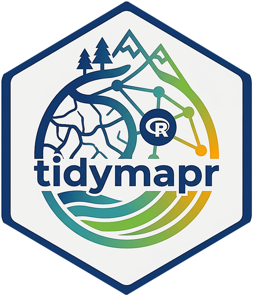

```{r, include = FALSE}
knitr::opts_chunk$set(
  dev.args = list(bg = "white"),
  collapse = TRUE,
  comment = "#>",
  fig.path = "man/figures/README-",
  out.width = "100%",
  dpi = 150
)
```

# tidymapr <a href="https://gitlab.com/jimmy.moses/tidymapr"></a>

<!-- badges: start -->
[](https://gitlab.com/jimmy.moses/tidymapr/-/pipelines)
[](https://lifecycle.r-lib.org/articles/stages.html#experimental)
[](https://gitlab.com/jimmy.moses/tidymapr/-/blob/main/LICENSE.md)
<!-- badges: end -->

<div class="tmr-hero">

**Tidy mapping verbs for biodiversity and spatial ecology.**

tidymapr is the mapping companion to
[tidydiversity](https://gitlab.com/jimmy.moses/tidydiversity). tidydiversity
estimates diversity, tidymapr puts it on a map, and the two work together
the way dplyr and ggplot2 do. Every verb takes a data frame and returns a
tibble, an `sf` table, a `SpatRaster` or a ggplot.

</div>

<div class="tmr-cards">
<div class="tmr-card">

### Sites and rasters

Sites as `sf` tables, raster values joined as columns, occurrence
cleaning and GBIF records, vector and raster verbs, GDAL-backed I/O.

</div>
<div class="tmr-card">

### Publication maps

Study-site maps, Hill numbers on maps and stems over topography, with
basemaps, scale bars and north arrows, saved at journal sizes.

</div>
<div class="tmr-card">

### Spatial ecology

Geographic and environmental distance decay, Moran's I, dbMEM, spatial
rarefaction, grain, mid-domain nulls and tidy species distribution models.

</div>
</div>

## Installation

Install the development version from GitLab:

```r
# install.packages("pak")
pak::pak("gitlab::jimmy.moses/tidymapr")
```

The source code lives on GitLab, <https://gitlab.com/jimmy.moses/tidymapr>, with a full mirror on Codeberg, <https://codeberg.org/jmoses/tidymapr>.

**sf**, **terra** and the other spatial packages are optional; install the
ones you need with `install.packages(c("sf", "terra"))`.

## Example

`png_ants` (from tidydiversity) records ground ants at baits along the
Mt Wilhelm elevational gradient in Papua New Guinea. Estimate richness
with tidydiversity and map it with tidymapr in one pipeline:

```{r example, message = FALSE, fig.height = 4.6, fig.alt = "Observed ant richness at each Mt Wilhelm site in the dry season"}
library(tidydiversity)
library(tidymapr)
library(dplyr)

sites <- geo_example_sites("wilhelm")

div_estimate(png_ants, q = 0, nboot = 0, .by = season) |>
  left_join(sites, by = "site") |>
  filter(season == "dry") |>
  plot_geo(estimate, lon, lat, label = site, basemap = "coast")
```

Site coordinates from `geo_example_sites()` are the published bait GPS of
the Mt Wilhelm ant survey (`png_ants_sites`; Mottl, Moses and Klimes 2023,
[doi:10.5281/zenodo.8191946](https://doi.org/10.5281/zenodo.8191946)).

## Functions

| Family | Functions |
|---|---|
| Sites and occurrences | `geo_as_sf()`, `geo_drop_geometry()`, `geo_extract()`, `geo_clean()`, `geo_gbif()`, `as_sf()`, `as_spat_raster()`, `geo_as_features()` |
| Distances and spatial statistics | `geo_distance()`, `geo_decay()`, `geo_moran()`, `geo_mem()`, `geo_rarefy_spatial()`, `geo_grain()`, `geo_middomain()` |
| Forest plot stem maps | `stems_quadrat()`, `stems_habitat()`, `stems_neighbours()`, `stems_habitat_test()` |
| Maps | `plot_sites()`, `plot_geo()`, `plot_topo()`, `geo_basemap()`, `geo_save()`, `theme_tidymapr()` |
| Vector and raster | `geo_read()`, `geo_write()`, `geo_vector_*()`, `geo_raster_*()`, `geo_buffer()`, `geo_crop()`, `geo_union()`, `geo_area()`, `geo_join()` |
| Environmental layers | `geo_bioclim()`, `geo_worldclim()`, `geo_chelsa()`, `geo_elevation()`, `geo_gadm()` |
| Species distribution models | `sdm_fit()`, `sdm_predict()`, `sdm_evaluate()`, `plot_sdm()` |
| Example data | `png_ants_sites` and `geo_example_sites()` (published Mt Wilhelm GPS); `geo_example_stems()`, `geo_example_dem()` and `geo_example_censuses()` (simulated, for tests only) |

## Gallery

```{r gallery-setup, include = FALSE}
library(ggplot2)
```

### Study-site map

```{r geo-sites, echo = FALSE, fig.height = 4.6, fig.alt = "Study-site map with coast basemap, labels, scale bar and north arrow"}
plot_sites(sites, lon, lat, colour = elevation_band, label = site, basemap = "coast")
```

### Stems over topography

```{r geo-topo, echo = FALSE, fig.height = 5, fig.alt = "Stem map over hillshade and contours"}
plot_topo(geo_example_stems(), colour = species, size = dbh, dem = geo_example_dem())
```

### Distance decay

```{r geo-decay, echo = FALSE, fig.height = 3.6, fig.alt = "Ant dissimilarity against great-circle distance by season"}
png_ants |>
  left_join(sites[c("site", "lon", "lat")], by = "site") |>
  geo_decay(lon, lat, .by = season, method = "haversine") |>
  autoplot()
```

See the [gallery](https://tidymapr-e72c18.gitlab.io/articles/gallery.html)
for every map with its table and code.

## Licence

MIT © 2026 Jimmy Moses
