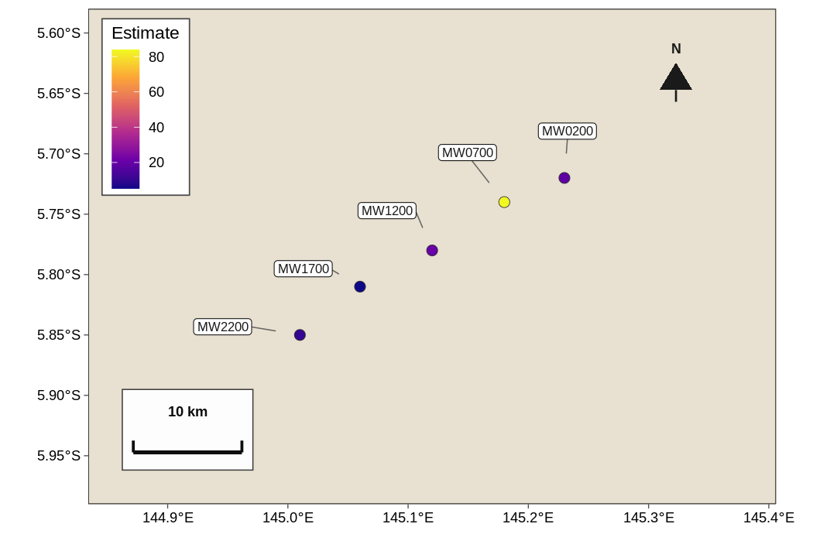
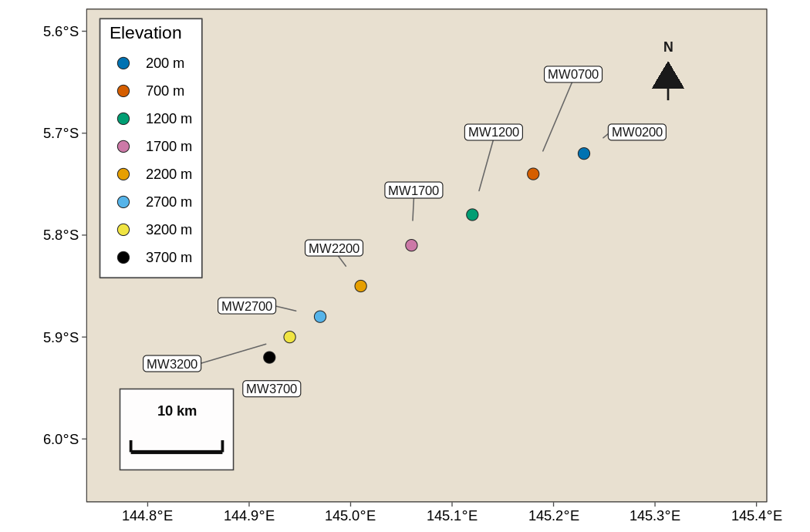
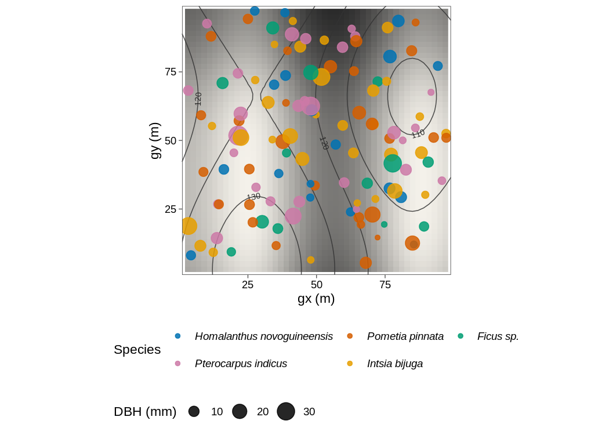
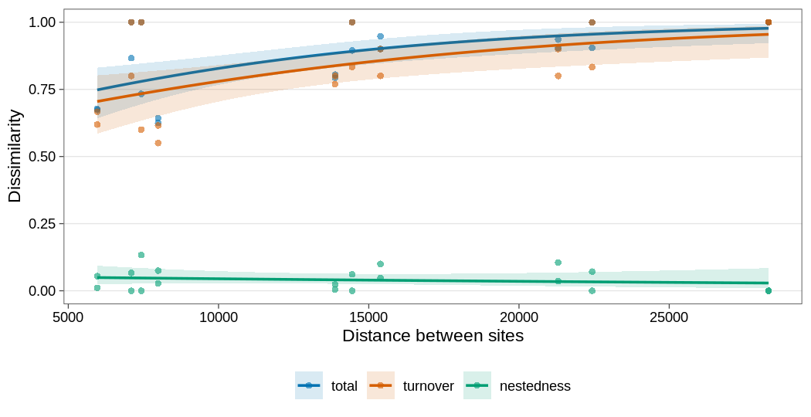

# tidymapr <a href="https://jmozez.github.io/tidymapr/"></a>

<!-- badges: start -->

[](https://github.com/jmozez/tidymapr/actions/workflows/R-CMD-check.yaml)
[](https://github.com/jmozez/tidymapr/actions/workflows/test-coverage.yaml)
[](https://github.com/jmozez/tidymapr/actions/workflows/lint.yaml)
[](https://jmozez.github.io/tidymapr/)
[](https://lifecycle.r-lib.org/articles/stages.html#experimental)
[](https://github.com/jmozez/tidymapr/blob/main/LICENSE.md)
<!-- badges: end -->

<div class="tmr-hero">

**Tidy mapping verbs for biodiversity and spatial ecology.**

tidymapr is the mapping companion to
[tidydiversity](https://jmozez.github.io/tidydiversity/). tidydiversity
estimates diversity, tidymapr puts it on a map, and the two work
together the way dplyr and ggplot2 do. Every verb takes a data frame and
returns a tibble, an `sf` table, a `SpatRaster` or a ggplot.

</div>

<div class="tmr-cards">

<div class="tmr-card">

### Sites and rasters

Sites as `sf` tables, raster values joined as columns, occurrence
cleaning and GBIF records, vector and raster verbs, GDAL-backed I/O.

</div>

<div class="tmr-card">

### Publication maps

Study-site maps, Hill numbers on maps and stems over topography, with
basemaps, scale bars and north arrows, saved at journal sizes.

</div>

<div class="tmr-card">

### Spatial ecology

Geographic and environmental distance decay, Moran’s I, dbMEM, spatial
rarefaction, grain, mid-domain nulls and tidy species distribution
models.

</div>

</div>

## Installation

Install the development version from GitHub:

``` r
# install.packages("pak")
pak::pak("jmozez/tidymapr")
```

**sf**, **terra** and the other spatial packages are optional; install
the ones you need with `install.packages(c("sf", "terra"))`.

## Example

`png_ants` (from tidydiversity) records ground ants at baits along the
Mt Wilhelm elevational gradient in Papua New Guinea. Estimate richness
with tidydiversity and map it with tidymapr in one pipeline:

``` r
library(tidydiversity)
library(tidymapr)
library(dplyr)

sites <- geo_example_sites("wilhelm")

div_estimate(png_ants, q = 0, nboot = 0, .by = season) |>
  left_join(sites, by = "site") |>
  filter(season == "dry") |>
  plot_geo(estimate, lon, lat, label = site, basemap = "coast")
```



Site coordinates from `geo_example_sites()` are illustrative; replace
them with your own GPS before publication.

## Functions

| Family                           | Functions                                                                                                                                |
| -------------------------------- | ---------------------------------------------------------------------------------------------------------------------------------------- |
| Sites and occurrences            | `geo_as_sf()`, `geo_drop_geometry()`, `geo_extract()`, `geo_clean()`, `geo_gbif()`, `as_sf()`, `as_spat_raster()`, `geo_as_features()`   |
| Distances and spatial statistics | `geo_distance()`, `geo_decay()`, `geo_moran()`, `geo_mem()`, `geo_rarefy_spatial()`, `geo_grain()`, `geo_middomain()`                    |
| Forest plot stem maps            | `stems_quadrat()`, `stems_habitat()`, `stems_neighbours()`, `stems_habitat_test()`                                                       |
| Maps                             | `plot_sites()`, `plot_geo()`, `plot_topo()`, `geo_basemap()`, `geo_save()`, `theme_tidymapr()`                                           |
| Vector and raster                | `geo_read()`, `geo_write()`, `geo_vector_*()`, `geo_raster_*()`, `geo_buffer()`, `geo_crop()`, `geo_union()`, `geo_area()`, `geo_join()` |
| Environmental layers             | `geo_bioclim()`, `geo_worldclim()`, `geo_chelsa()`, `geo_elevation()`, `geo_gadm()`                                                      |
| Species distribution models      | `sdm_fit()`, `sdm_predict()`, `sdm_evaluate()`, `plot_sdm()`                                                                             |
| Example data                     | `geo_example_sites()`, `geo_example_stems()`, `geo_example_dem()`, `geo_example_censuses()`                                              |

## Gallery

### Study-site map



### Stems over topography



### Distance decay



See the
[gallery](https://jmozez.github.io/tidymapr/articles/gallery.html) for
every map with its table and code.

## Licence

MIT © 2026 Jimmy Moses
