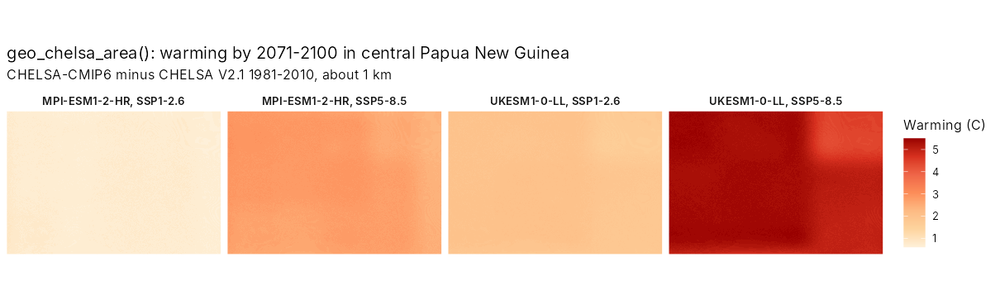
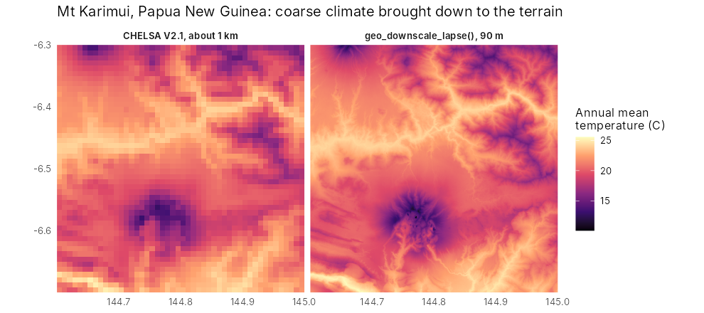
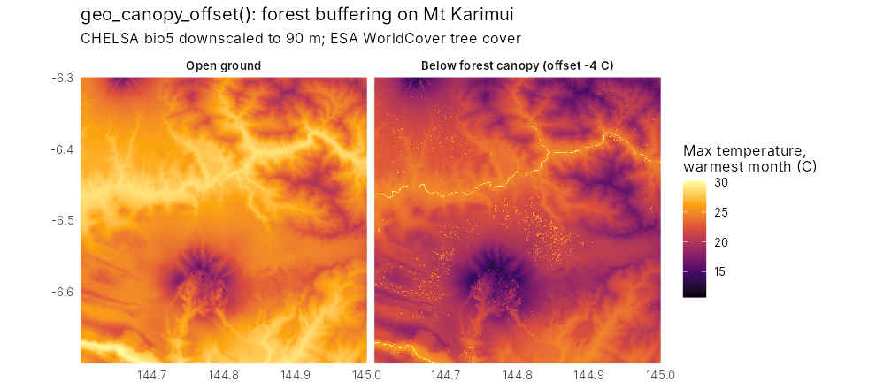
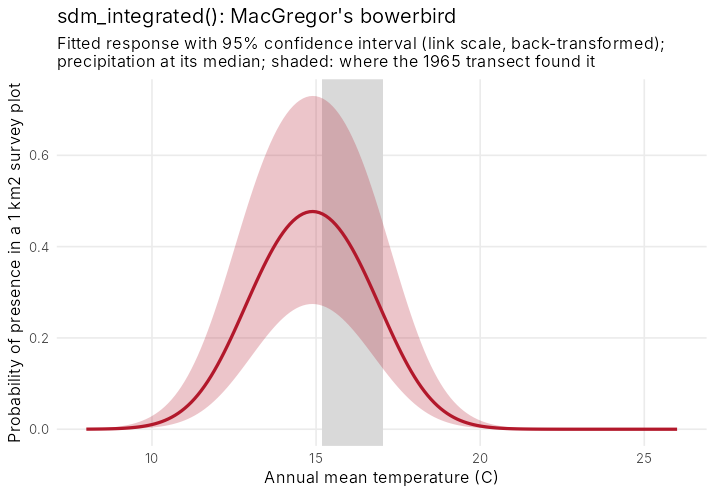
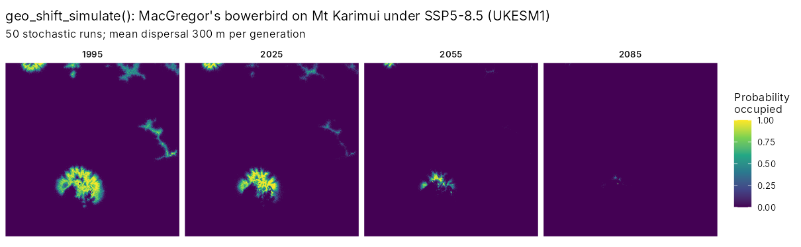
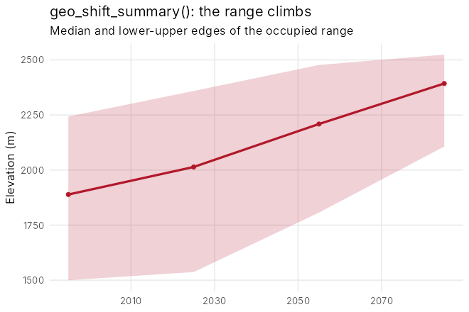
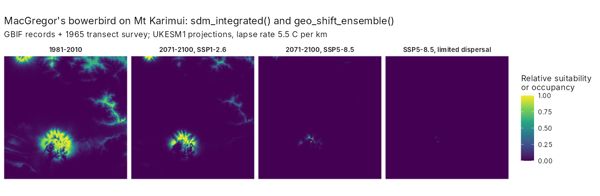
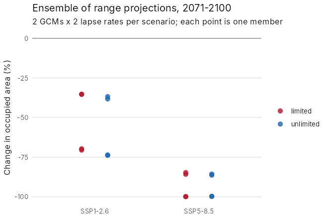
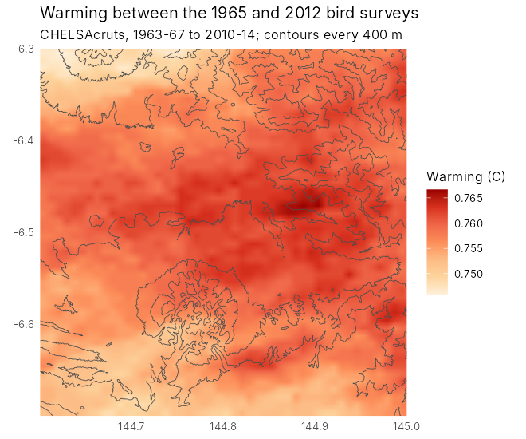
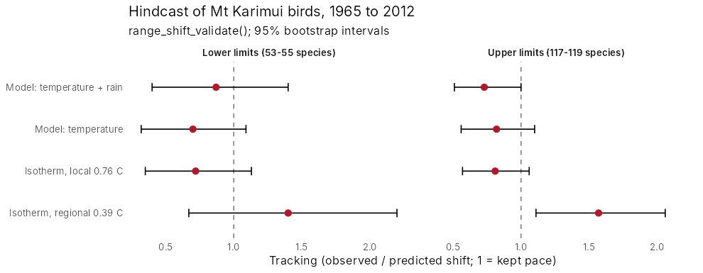

# 11. Range shifts under climate change

tidymapr 0.3.0 adds a hybrid model of range shifts: fine-scale climate,
an integrated niche model and a simulation of colonisation and
extinction, run over an ensemble of climate futures. This chapter walks
through it for MacGregor’s bowerbird (*Amblyornis macgregoriae*) on Mt
Karimui, Papua New Guinea, with real data: CHELSA climate, GBIF records,
the SRTM elevation model and ESA WorldCover. The figures were made with
the code shown; the code needs an internet connection and is not run
when this page is built.

| Step | Functions |
|----|----|
| Climate for an area, now and in the future | [`geo_chelsa_area()`](https://tidymapr.in4metrix.dev/reference/geo-climate.md), [`geo_chelsa_urls()`](https://tidymapr.in4metrix.dev/reference/geo-climate.md) |
| Down to the terrain and below the canopy | [`geo_downscale_lapse()`](https://tidymapr.in4metrix.dev/reference/geo-climate.md), [`geo_canopy_offset()`](https://tidymapr.in4metrix.dev/reference/geo-climate.md) |
| Niche from records and surveys | [`sdm_integrated()`](https://tidymapr.in4metrix.dev/reference/sdm_integrated.md) |
| Dispersal, colonisation and extinction | [`geo_shift_simulate()`](https://tidymapr.in4metrix.dev/reference/geo_shift_simulate.md), [`geo_shift_summary()`](https://tidymapr.in4metrix.dev/reference/geo_shift_simulate.md) |
| Ensembles of futures | [`geo_climate_scenarios()`](https://tidymapr.in4metrix.dev/reference/geo-shift-ensemble.md), [`geo_shift_ensemble()`](https://tidymapr.in4metrix.dev/reference/geo-shift-ensemble.md) |

## 1. Climate for an area

[`geo_chelsa_area()`](https://tidymapr.in4metrix.dev/reference/geo-climate.md)
reads CHELSA V2.1 (1981-2010) and CHELSA-CMIP6 projections for five
climate models (GCMs), three emission scenarios (SSPs) and three
periods. Only the window over the area is read, so a region takes
seconds.

``` r

library(tidymapr)
png <- c(143, -8, 147.5, -5)
now <- geo_chelsa_area(png, "bio1")
future <- geo_chelsa_area(png, "bio1",
  period = "2071-2100",
  gcm = c("mpi-esm1-2-hr", "ukesm1-0-ll"), ssp = c("ssp126", "ssp585")
)
warming <- future - now
```



The models disagree: by 2071-2100, central New Guinea warms by about 1
degree C under SSP1-2.6 with MPI-ESM1-2-HR and by over 5 degrees C under
SSP5-8.5 with UKESM1. Projections should span that range.

## 2. Down to the terrain and below the canopy

A 1 km cell on a tropical mountain can span over 1,000 m of elevation,
about 5 degrees C.
[`geo_downscale_lapse()`](https://tidymapr.in4metrix.dev/reference/geo-climate.md)
corrects each fine cell by its height above or below the cell’s mean,
with a lapse rate measured on the mountain (5.1 degrees C per km on Mt
Karimui).

``` r

area <- c(144.6, -6.7, 145.0, -6.3)
dem <- geo_elevation(bbox = area, buffer = 0)[[1]]
bio1 <- geo_downscale_lapse(geo_chelsa_area(area, "bio1"), dem, lapse_rate = 5.1)
```



Below a closed canopy, maximum temperatures are several degrees lower
than in the open.
[`geo_canopy_offset()`](https://tidymapr.in4metrix.dev/reference/geo-climate.md)
adds that buffer, scaled by canopy cover.

``` r

bio5 <- geo_downscale_lapse(geo_chelsa_area(area, "bio5"), dem, 5.1)
trees <- geo_landcover(area, template = dem) == 10
forest_bio5 <- geo_canopy_offset(bio5, terra::resample(trees * 1, dem, "average"), offset = -4)
```



## 3. A niche from records and surveys

GBIF records are many but biased towards roads and towns; standardised
surveys are few but unbiased.
[`sdm_integrated()`](https://tidymapr.in4metrix.dev/reference/sdm_integrated.md)
fits one niche to both: presence-only records as a point process and
surveys as presence-absence. Here, 300 GBIF records are combined with
the 1965 transect on Mt Karimui, where the bowerbird was found between
1,585 and 1,981 m. `unimodal = "bio1"` forces a hump-shaped response to
temperature, so the model cannot predict ever-rising suitability in
warmer climates.

``` r

fit <- sdm_integrated(
  presence = gbif_climate, background = background, area = n_cells,
  survey = transect_1965, covariates = c("bio1", "bio12"), unimodal = "bio1"
)
```



The curve and its band come straight from the fitted model:
`predict(fit, newdata, se_fit = TRUE)` returns the standard error of the
linear predictor (from the covariance of the estimates) and a 95%
confidence interval formed on the link scale and back-transformed, so it
stays between 0 and 1.

``` r

curve <- data.frame(bio1 = seq(8, 26, 0.1), bio12 = 4030)
cbind(curve, predict(fit, curve, se_fit = TRUE))
```

## 4. Dispersal, colonisation and extinction

Suitable climate is not enough: a species has to reach it.
[`geo_shift_simulate()`](https://tidymapr.in4metrix.dev/reference/geo_shift_simulate.md)
runs a stochastic patch-occupancy model on a series of suitability maps.
Each generation an empty cell is colonised with a probability that rises
with occupied cells nearby (a negative exponential dispersal kernel),
and an occupied cell persists with a probability set by its suitability.
The model is written in C++ and runs in parallel; results do not depend
on the number of cores.

``` r

suit <- c(now_suit, suit_2025, suit_2055, suit_2085)
sim <- geo_shift_simulate(suit,
  dispersal_mean = 300, steps_per_layer = 3, nsim = 50, seed = 1
)
geo_shift_summary(sim, elevation = dem)
```





Under SSP5-8.5 with UKESM1 the occupied area shrinks from 74 km^2 in
1995 to 41 km^2 by 2025, 9 km^2 by 2055 and under 1 km^2 by 2085, while
the median elevation of the occupied range climbs from 1,890 to 2,390 m:
the range runs out of mountain. Suitability here is relative (divided by
its present maximum), so that the best present habitat persists from one
generation to the next.

## 5. Ensembles of futures

[`geo_climate_scenarios()`](https://tidymapr.in4metrix.dev/reference/geo-shift-ensemble.md)
builds every combination of GCM, SSP and lapse rate on the fine grid;
[`geo_shift_ensemble()`](https://tidymapr.in4metrix.dev/reference/geo-shift-ensemble.md)
runs the niche model and the simulation on each, with limited and
unlimited dispersal, and
[`summary()`](https://rspatial.github.io/terra/reference/summary.html)
gives the probability of losing more than 30, 50 or 80% of the range.

``` r

sc <- geo_climate_scenarios(area, dem,
  variables = c("bio1", "bio12"), period = "2071-2100",
  gcm = c("mpi-esm1-2-hr", "ukesm1-0-ll"), ssp = c("ssp126", "ssp585"),
  lapse_rates = c(4.5, 5.5)
)
ens <- geo_shift_ensemble(fit, sc, dispersal_mean = 300, steps = 8, nsim = 20)
summary(ens)
```





Every member loses range. Under SSP1-2.6 the median loss is 53% with
limited dispersal (35 to 71% across members); under SSP5-8.5 it is 93%
(85 to 100%), and every member loses more than half of the range. Which
climate model is used matters as much as the scenario; the lapse rate
matters little here. Limited and unlimited dispersal agree because the
bowerbird only needs to move a short way upslope: dispersal limits
matter most for species that must cross gaps.

## 6. Does it work? A hindcast

The workflow was tested on birds resurveyed on Mt Karimui in 1965 and
2012 (Freeman and Class Freeman 2014). Using warming measured on the
mountain, the predicted shifts matched the observed community-wide
shifts; see the [full case
study](https://tidymapr.in4metrix.dev/articles/case-karimui-hindcast.md).



## References

De Frenne, P. et al. (2019). Global buffering of temperatures under
forest canopies. Nature Ecology & Evolution, 3, 744-749.

Fithian, W., Elith, J., Hastie, T. and Keith, D. A. (2015). Bias
correction in species distribution models: pooling survey and collection
data for multiple species. Methods in Ecology and Evolution, 6, 424-438.

Freeman, B. G. and Class Freeman, A. M. (2014). Rapid upslope shifts in
New Guinean birds illustrate strong distributional responses of tropical
montane species to global warming. PNAS, 111, 4490-4494.

Hanski, I. (1998). Metapopulation dynamics. Nature, 396, 41-49.

Karger, D. N. et al. (2017). Climatologies at high resolution for the
earth’s land surface areas. Scientific Data, 4, 170122.
