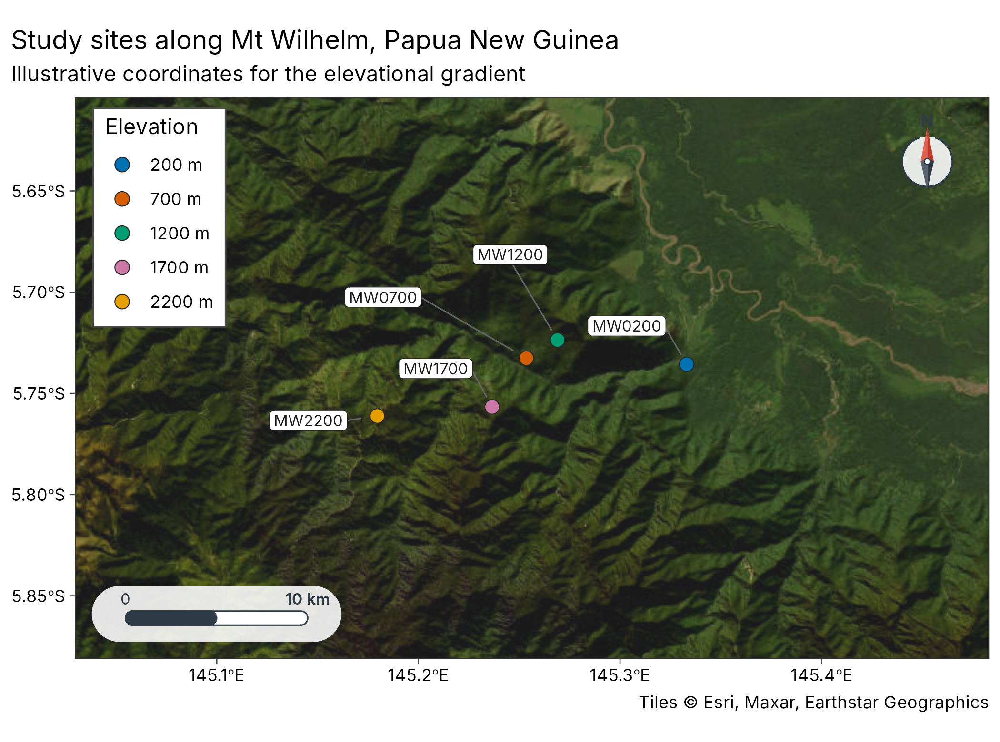
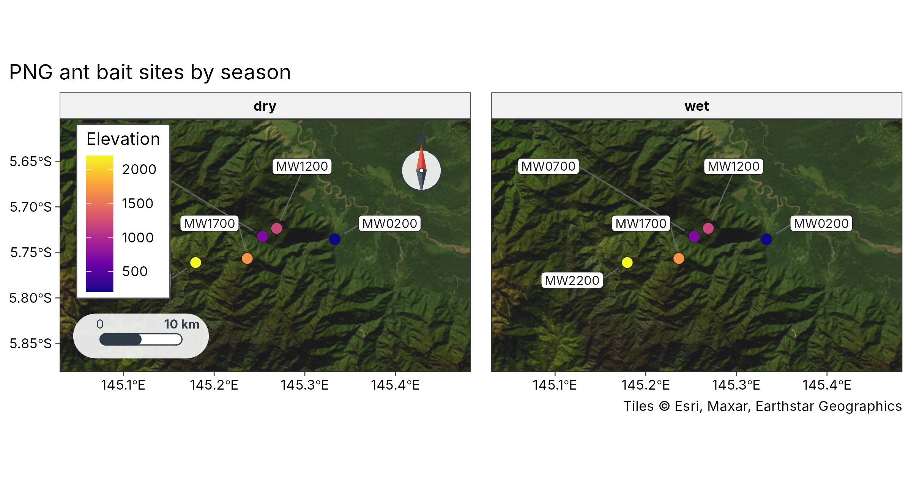
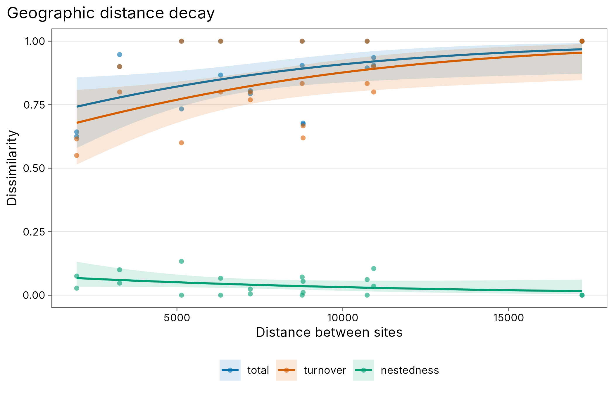
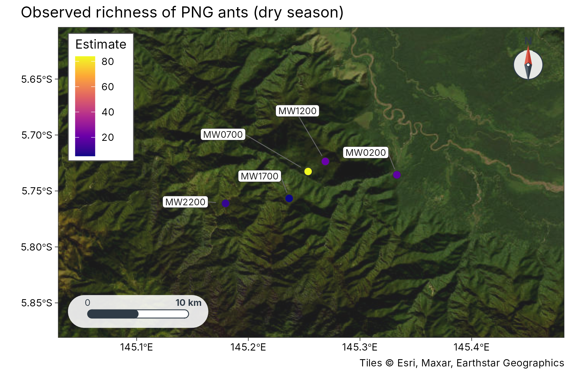
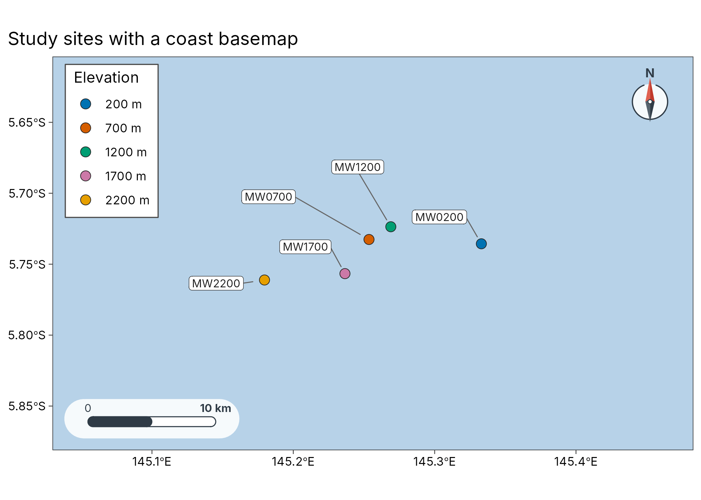
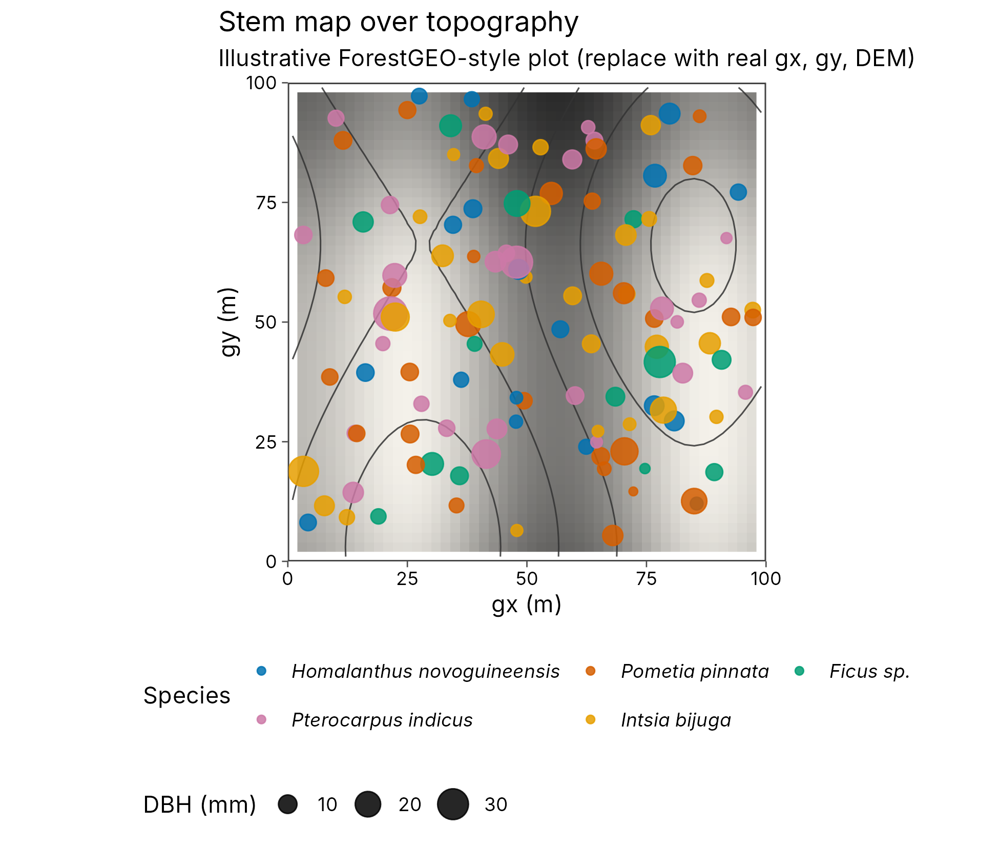
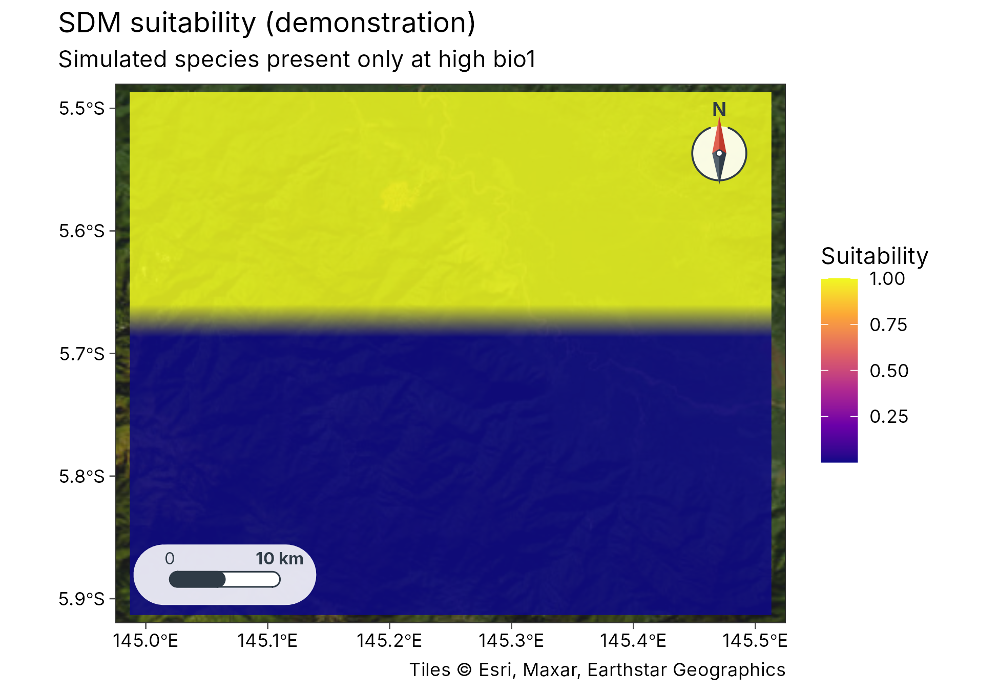
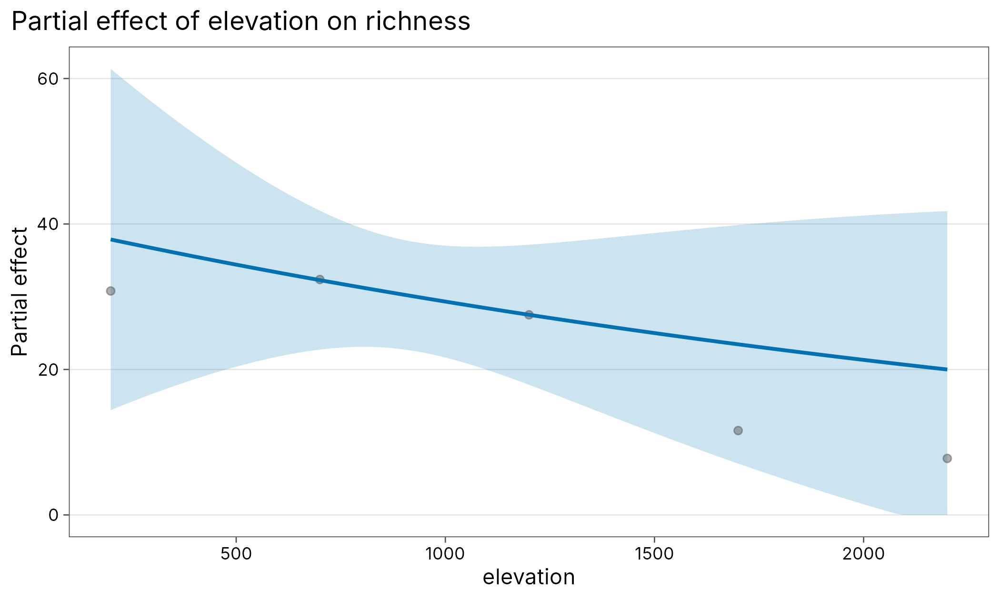
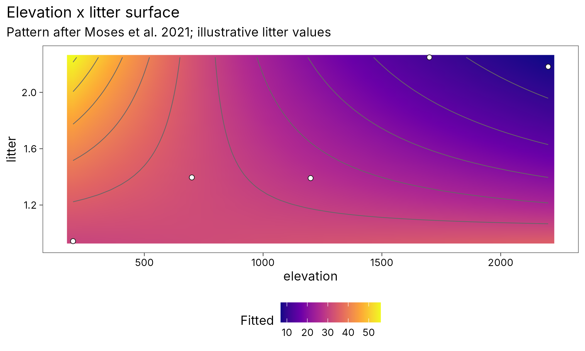

# Geospatial diversity workflows

``` r
library(tidydiversity)
library(tidymapr)
```

tidymapr and tidydiversity share one tidy pipeline, in the same way
dplyr and ggplot2 do: tidydiversity estimates diversity, tidymapr puts
it on a map. This article covers study-site maps for papers, sites as
`sf` tables, rasters joined as columns, occurrence cleaning, distances
for
[`tidydiversity::beta_decay()`](https://rdrr.io/pkg/tidydiversity/man/beta_decay.html),
Hill numbers on maps, stem maps over topography, WorldClim/CHELSA
bioclim (including CMIP6), tidy SDMs (`sdm_*`) and Moran’s I for spatial
autocorrelation. Hand off to **tmap** or **leaflet** with
[`as_sf()`](https://tidymapr.in4metrix.dev/reference/geo-map-interop.md)
/
[`as_spat_raster()`](https://tidymapr.in4metrix.dev/reference/geo-map-interop.md)
when you want interactive maps; those stay Suggests only. Diversity,
stem and modelling verbs (`div_*`, `beta_*`, `stems_*`, `model_*`,
[`plot_partial()`](https://rdrr.io/pkg/tidydiversity/man/plot-partial.html))
come from tidydiversity.

## Study-site map (publication figure)

Papers almost always need a map of the sampling sites. The Mt Wilhelm
ant survey behind
[`tidydiversity::png_ants`](https://rdrr.io/pkg/tidydiversity/man/png_ants.html)
comes with published bait GPS positions (\[png_ants_sites\]; Mottl,
Moses and Klimes 2023,
[doi:10.5281/zenodo.8191946](https://doi.org/10.5281/zenodo.8191946)),
and \[geo_example_sites()\] returns them as one point per elevation
band.

``` r
sites <- geo_example_sites("wilhelm")
# Keep the five elevations shared by both seasons in png_ants
sites <- sites[sites$elevation <= 2200, ]
sites$season <- "both"

plot_sites(
  sites,
  lon,
  lat,
  colour = elevation_band,
  label = site,
  scale_bar = TRUE,
  north_arrow = TRUE
) +
  ggplot2::labs(
    title = "Study sites along Mt Wilhelm, Papua New Guinea",
    subtitle = "Illustrative coordinates for the elevational gradient"
  )
```



Join the same coordinates to community data when you need a map per
season or taxon:

``` r
ants <- unique(png_ants[c("site", "elevation", "season")])
ants <- dplyr::left_join(ants, sites[c("site", "lon", "lat")], by = "site")
plot_sites(
  ants,
  lon,
  lat,
  colour = elevation,
  facet = season,
  label = site
) +
  ggplot2::labs(title = "PNG ant bait sites by season")
```



## Sites and rasters

``` r
sites <- geo_example_sites("wilhelm")
sites <- sites[sites$elevation <= 2200, ]
sf_sites <- geo_as_sf(sites, lon, lat, site = site)
sf_sites
#> Simple feature collection with 5 features and 6 fields
#> Geometry type: POINT
#> Dimension:     XY
#> Bounding box:  xmin: 145.1796 ymin: -5.76114 xmax: 145.333 ymax: -5.72361
#> Geodetic CRS:  WGS 84
#> # A tibble: 5 × 7
#>   site     lon   lat elevation elevation_band coordinate_note                   
#> * <chr>  <dbl> <dbl>     <int> <fct>          <chr>                             
#> 1 MW0200  145. -5.74       200 200 m          published bait GPS, doi:10.5281/z…
#> 2 MW0700  145. -5.73       700 700 m          published bait GPS, doi:10.5281/z…
#> 3 MW1200  145. -5.72      1200 1200 m         published bait GPS, doi:10.5281/z…
#> 4 MW1700  145. -5.76      1700 1700 m         published bait GPS, doi:10.5281/z…
#> 5 MW2200  145. -5.76      2200 2200 m         published bait GPS, doi:10.5281/z…
#> # ℹ 1 more variable: geometry <POINT [°]>
```

``` r
# Demo raster in place of CHELSA / WorldClim / SRTM
r <- terra::rast(
  ncols = 40, nrows = 40,
  xmin = 144.8, xmax = 145.5, ymin = -6.0, ymax = -5.5,
  crs = "EPSG:4326"
)
terra::values(r) <- sites$elevation[1] +
  800 * (terra::yFromCell(r, seq_len(terra::ncell(r))) + 6)
names(r) <- "elev_proxy"
sites_x <- geo_extract(sites, r, lon, lat)
sites_x
#> # A tibble: 5 × 7
#>   site     lon   lat elevation elevation_band coordinate_note         elev_proxy
#>   <chr>  <dbl> <dbl>     <int> <fct>          <chr>                        <dbl>
#> 1 MW0200  145. -5.74       200 200 m          published bait GPS, do…       415 
#> 2 MW0700  145. -5.73       700 700 m          published bait GPS, do…       415 
#> 3 MW1200  145. -5.72      1200 1200 m         published bait GPS, do…       425 
#> 4 MW1700  145. -5.76      1700 1700 m         published bait GPS, do…       395.
#> 5 MW2200  145. -5.76      2200 2200 m         published bait GPS, do…       395.
```

## Clean occurrence records

``` r
occ <- tibble::tibble(
  species = c("Camponotus_sp1", "Camponotus_sp1", "Polyrhachis_sp2",
              "Pheidole_sp3", "ghost"),
  lon = c(145.23, 145.23, 145.12, 0, 12.58),
  lat = c(-5.72, -5.72, -5.78, 0, 55.67)
)
geo_clean(occ, lon, lat, species = species, value = "flagged")[
  c("species", "lon", "lat", ".zer", ".gbf", ".dpl", ".summary")
]
#> # A tibble: 5 × 7
#>   species           lon   lat .zer  .gbf  .dpl  .summary
#>   <chr>           <dbl> <dbl> <lgl> <lgl> <lgl> <lgl>   
#> 1 Camponotus_sp1  145.  -5.72 FALSE FALSE TRUE  FALSE   
#> 2 Camponotus_sp1  145.  -5.72 FALSE FALSE TRUE  TRUE    
#> 3 Polyrhachis_sp2 145.  -5.78 FALSE FALSE FALSE FALSE   
#> 4 Pheidole_sp3      0    0    TRUE  FALSE FALSE TRUE    
#> 5 ghost            12.6 55.7  FALSE TRUE  FALSE TRUE
```

[`geo_gbif()`](https://tidymapr.in4metrix.dev/reference/geo_gbif.md)
accepts a pre-downloaded GBIF table (or downloads with **rgbif** when
installed) and pipes into the same cleaner.

## Distance decay with tidydiversity

``` r
com <- dplyr::left_join(
  png_ants,
  sites[c("site", "lon", "lat")],
  by = "site"
)
decay_geo <- geo_decay(com, lon, lat, .by = season, method = "haversine")
decay_elev <- geo_decay(
  com, elevation = elevation, .by = season, method = "elevation"
)
head(decay_geo)
#> # A tibble: 6 × 7
#>   season site_1 site_2 turnover nestedness total distance
#>   <chr>  <chr>  <chr>     <dbl>      <dbl> <dbl>    <dbl>
#> 1 dry    MW0200 MW0700    0.667     0.0108 0.677    8802.
#> 2 dry    MW0200 MW1200    0.769     0.0239 0.793    7212.
#> 3 dry    MW0200 MW1700    0.8       0.105  0.905   10931.
#> 4 dry    MW0200 MW2200    1         0      1       17211.
#> 5 dry    MW0700 MW1200    0.615     0.0275 0.643    1978.
#> 6 dry    MW0700 MW1700    0.8       0.1    0.9      3272.
```

``` r
ggplot2::autoplot(decay_geo) + ggplot2::labs(title = "Geographic distance decay")
```



## Map Hill numbers

``` r
est <- div_estimate(png_ants, q = 0, nboot = 0, .by = season)
est <- dplyr::left_join(est, sites[c("site", "lon", "lat")], by = "site")
est_dry <- est[est$season == "dry", ]
plot_geo(est_dry, estimate, lon, lat, label = site) +
  ggplot2::labs(title = "Observed richness of PNG ants (dry season)")
```



## Spatial autocorrelation

``` r
set.seed(1)
g <- expand.grid(x = 1:8, y = 1:8)
g$richness <- g$x + g$y + 0.05 * stats::rnorm(nrow(g))
geo_moran(g, richness, lon = x, lat = y, nperm = 199, correlogram = TRUE)
#> # A tibble: 1 × 7
#>   statistic expectation variance p.value     n nperm method                     
#>       <dbl>       <dbl>    <dbl>   <dbl> <int> <dbl> <chr>                      
#> 1     0.314     -0.0159 0.000220   0.005    64   199 Moran's I (inverse-distanc…
```

## Basemaps

[`plot_sites()`](https://tidymapr.in4metrix.dev/reference/plot_sites.md)
and [`plot_geo()`](https://tidymapr.in4metrix.dev/reference/plot_geo.md)
take a `basemap` argument. Use `"coast"` offline, online tile names
(`"osm"`, `"carto"`, `"carto_dark"`, `"esri"`) when connected, or pass a
`SpatRaster` / file path. Tile fetch failures fall back to the coast
basemap with a message. Scale bar and north arrow stay on.

``` r
sites <- geo_example_sites("wilhelm")
sites <- sites[sites$elevation <= 2200, ]
plot_sites(
  sites, lon, lat,
  colour = elevation_band,
  label = site,
  basemap = "coast"
) +
  ggplot2::labs(title = "Study sites with a coast basemap")
#> Warning: No Natural Earth land data available; install rnaturalearth.
#> ℹ Returning an empty land layer. Pass `coastline` or use a tile basemap.
```



## Vector and raster analysis

Buffer sites, then summarise a raster inside each buffer (for example
mean elevation). Crop and mask keep the analysis inside the study area.

``` r
sites_sf <- geo_as_sf(sites, lon, lat)
buf <- geo_buffer(sites_sf, dist = 5000)
r <- terra::rast(
  ncols = 40, nrows = 40,
  xmin = 144.8, xmax = 145.5, ymin = -6.0, ymax = -5.5,
  crs = "EPSG:4326"
)
terra::values(r) <- sites$elevation[1] +
  800 * (terra::yFromCell(r, seq_len(terra::ncell(r))) + 6)
names(r) <- "elev_proxy"
geo_raster_zonal(r, buf, fun = "mean")
#> # A tibble: 5 × 7
#>   site     lon   lat elevation elevation_band coordinate_note         elev_proxy
#>   <chr>  <dbl> <dbl>     <int> <fct>          <chr>                        <dbl>
#> 1 MW0200  145. -5.74       200 200 m          published bait GPS, do…       411.
#> 2 MW0700  145. -5.73       700 700 m          published bait GPS, do…       414.
#> 3 MW1200  145. -5.72      1200 1200 m         published bait GPS, do…       423.
#> 4 MW1700  145. -5.76      1700 1700 m         published bait GPS, do…       394.
#> 5 MW2200  145. -5.76      2200 2200 m         published bait GPS, do…       393.
cropped <- geo_raster_crop(r, buf)
masked <- geo_raster_mask(r, buf)
c(ncell_full = terra::ncell(r), ncell_crop = terra::ncell(cropped))
#> ncell_full ncell_crop 
#>       1600        140
```

## Bioclimatic variables (WorldClim and CHELSA)

Biodiversity models often need temperature and rainfall surfaces. List
the 19 bioclim variables with \[geo_bioclim_vars()\], then read or
download them with \[geo_worldclim()\] or \[geo_chelsa()\] (or the front
door \[geo_bioclim()\]). Pass `path` for local GeoTIFFs when offline.
Cite the data sources in any paper that uses them: WorldClim 2 (Fick and
Hijmans 2017, CC BY 4.0) and CHELSA (Karger et al. 2017, CC BY 4.0).

``` r
geo_bioclim_vars()[c(1, 12), ]
#> # A tibble: 2 × 4
#>   code  name                    description             unit 
#>   <chr> <chr>                   <chr>                   <chr>
#> 1 bio1  annual_mean_temperature Annual mean temperature deg_C
#> 2 bio12 annual_precipitation    Annual precipitation    mm
```

``` r
# Offline demo: a local stand-in for bio1 joined to sites
bio1 <- terra::rast(
  ncols = 20, nrows = 20,
  xmin = 144.8, xmax = 145.5, ymin = -6.0, ymax = -5.5,
  crs = "EPSG:4326"
)
terra::values(bio1) <- 22
names(bio1) <- "bio1"
tmp <- tempfile(fileext = ".tif")
terra::writeRaster(bio1, tmp, overwrite = TRUE)
clim <- geo_worldclim(vars = "bio1", path = tmp, download = FALSE)
geo_extract(sites, clim, lon, lat)
#> # A tibble: 5 × 7
#>   site     lon   lat elevation elevation_band coordinate_note               bio1
#>   <chr>  <dbl> <dbl>     <int> <fct>          <chr>                        <dbl>
#> 1 MW0200  145. -5.74       200 200 m          published bait GPS, doi:10.…    22
#> 2 MW0700  145. -5.73       700 700 m          published bait GPS, doi:10.…    22
#> 3 MW1200  145. -5.72      1200 1200 m         published bait GPS, doi:10.…    22
#> 4 MW1700  145. -5.76      1700 1700 m         published bait GPS, doi:10.…    22
#> 5 MW2200  145. -5.76      2200 2200 m         published bait GPS, doi:10.…    22
```

## Tree stems over topography (ForestGEO / Wanang)

Large forest dynamics plots map every stem in local metre coordinates
(`gx`, `gy`) over a DEM. \[plot_topo()\] draws stems with contour lines
and hillshade, coloured by species and sized by DBH. The package does
not yet ship real Wanang stem coordinates; \[geo_example_stems()\] and
\[geo_example_dem()\] give an illustrative 100 m x 100 m plot in the
ForestGEO column layout. Replace them with your inventory for
publication. ForestGEO / Wanang background: Anderson-Teixeira et
al. (2015), <doi:10.1111/gcb.12712>; ForestGEO
<https://forestgeo.si.edu/>.

``` r
stems <- geo_example_stems()
dem <- geo_example_dem()
plot_topo(
  stems,
  colour = species,
  size = dbh,
  dem = dem,
  boundary = c(0, 0, 100, 100)
) +
  ggplot2::labs(
    title = "Stem map over topography",
    subtitle = "Illustrative ForestGEO-style plot (replace with real gx, gy, DEM)"
  )
```



## ForestGEO-style plots

Forest dynamics plots (ForestGEO / CTFS) map every stem in local metres
and repeat the census about every five years (Condit 1998;
Anderson-Teixeira et al. 2015). tidymapr handles the spatial steps and
tidydiversity the census summaries:

1.  [`tidydiversity::stems_as_trees()`](https://rdrr.io/pkg/tidydiversity/man/stems.html)
    picks the main stem per tree.
2.  \[stems_quadrat()\] assigns 20 m x 20 m quadrats from `gx` / `gy`.
3.  [`tidydiversity::stems_abundance()`](https://rdrr.io/pkg/tidydiversity/man/stems.html)
    and
    [`tidydiversity::stems_basal_area()`](https://rdrr.io/pkg/tidydiversity/man/stems.html)
    summarise counts and basal area (`pi/4 * dbh^2`).
4.  [`tidydiversity::stems_size_class()`](https://rdrr.io/pkg/tidydiversity/man/stems.html)
    bins DBH.
5.  [`tidydiversity::stems_demography()`](https://rdrr.io/pkg/tidydiversity/man/stems.html)
    estimates mortality, recruitment and growth between two censuses.
6.  \[stems_habitat()\] joins quadrat topography or habitat,
    \[stems_neighbours()\] counts neighbours within a radius and
    \[stems_habitat_test()\] runs the torus-translation habitat test.
7.  [`tidydiversity::stems_as_community()`](https://rdrr.io/pkg/tidydiversity/man/stems.html)
    feeds
    [`tidydiversity::div_hill()`](https://rdrr.io/pkg/tidydiversity/man/div_hill.html)
    and friends.
8.  \[plot_topo()\] maps stems on hillshade and contours.

``` r
stems <- geo_example_stems()
stems_basal_area(stems, dbh_unit = "mm", .by = species)
#> # A tibble: 5 × 4
#>   species                    basal_area basal_area_unit n_stem
#>   <chr>                           <dbl> <chr>            <int>
#> 1 Homalanthus_novoguineensis       799. mm2                 13
#> 2 Pometia_pinnata                 2004. mm2                 23
#> 3 Ficus_sp                        1357. mm2                  8
#> 4 Pterocarpus_indicus             3459. mm2                 22
#> 5 Intsia_bijuga                   2215. mm2                 20
cens <- geo_example_censuses()
stems_demography(cens$census1, cens$census2, time = 5, dbh_unit = "mm")
#> # A tibble: 1 × 12
#>       N     S     D     R mortality_rate recruitment_rate growth_rate growth  
#>   <int> <int> <int> <int>          <dbl>            <dbl>       <dbl> <chr>   
#> 1    80    74     6     8         0.0156           0.0205       0.460 absolute
#> # ℹ 4 more variables: n_growth <int>, time <dbl>, mindbh <dbl>, dbh_unit <chr>
com <- stems_as_community(stems_quadrat(stems))
div_hill(com, q = c(0, 1, 2))
#> # A tibble: 75 × 4
#>    site      q     n diversity
#>    <chr> <dbl> <dbl>     <dbl>
#>  1 0_0       0     4      3   
#>  2 0_0       1     4      2.83
#>  3 0_0       2     4      2.67
#>  4 0_20      0     2      2   
#>  5 0_20      1     2      2   
#>  6 0_20      2     2      2   
#>  7 0_40      0     3      3   
#>  8 0_40      1     3      3   
#>  9 0_40      2     3      3   
#> 10 0_60      0     1      1   
#> # ℹ 65 more rows
```

## Environmental distance decay

After joining bioclim columns with \[geo_extract()\] /
\[geo_bioclim()\], pass `method = "environmental"` to \[geo_distance()\]
or \[geo_decay()\] to get Euclidean (scaled) or Gower distances among
sites. The result feeds
[`tidydiversity::beta_decay_model()`](https://rdrr.io/pkg/tidydiversity/man/beta_decay_model.html)
the same way as geographic or elevational distance.

``` r
sites <- unique(png_ants[c("site", "elevation", "season")])
sites$lon <- 145.0 + sites$elevation / 1e5
sites$lat <- -5.8 - sites$elevation / 2e5
sites$bio1 <- 25 - sites$elevation / 400
com <- dplyr::left_join(
  dplyr::filter(png_ants, season == "wet"),
  sites[c("site", "season", "lon", "lat", "bio1")],
  by = c("site", "season")
)
decay <- geo_decay(com, lon, lat, method = "environmental", vars = "bio1")
head(decay)
#> # A tibble: 6 × 6
#>   site_1 site_2 turnover nestedness total distance
#>   <chr>  <chr>     <dbl>      <dbl> <dbl>    <dbl>
#> 1 MW0200 MW0700    0.619    0.0544  0.673    0.632
#> 2 MW0200 MW1200    0.8      0.00488 0.805    1.26 
#> 3 MW0200 MW1700    0.9      0.0355  0.935    1.90 
#> 4 MW0200 MW2200    1        0       1        2.53 
#> 5 MW0700 MW1200    0.55     0.075   0.625    0.632
#> 6 MW0700 MW1700    0.9      0.0474  0.947    1.26
```

## Spatial eigenvectors, rarefaction and grain

\[geo_mem()\] builds dbMEM / PCNM eigenvectors from site coordinates.
\[geo_rarefy_spatial()\] accumulates richness by distance from a seed
sample. \[geo_grain()\] rebins sites into square cells of several sizes
and recomputes Hill numbers, so MAUP / grain effects are visible.
\[geo_middomain()\] adds a geometric mid-domain null for elevational
richness.

``` r
g <- expand.grid(lon = 1:5, lat = 1:4)
g$site <- paste0("s", seq_len(nrow(g)))
names(geo_mem(g, lon, lat, site = site, method = "euclidean"))[1:6]
#> [1] "site" "lon"  "lat"  "MEM1" "MEM2" "MEM3"
```

## Tidy species distribution models

\[sdm_fit()\], \[sdm_predict()\], \[sdm_evaluate()\] and \[plot_sdm()\]
provide a tidyverse-style SDM workflow. Engines: `"glm"`, `"gam"` (mgcv)
and a native `"maxnet"`-like presence-background model with linear and
quadratic features (no Java Maxent, no biomod2 or dismo). Predictors may
be columns or a SpatRaster from \[geo_bioclim()\].

``` r
set.seed(1)
grid <- expand.grid(
  lon = seq(145, 145.5, length.out = 20),
  lat = seq(-5.9, -5.5, length.out = 16)
)
grid$bio1 <- 15 + 12 * (grid$lat - min(grid$lat)) / diff(range(grid$lat))
pa <- grid
pa$present <- as.integer(pa$bio1 > 22)
fit <- sdm_fit(pa, predictors = "bio1", present = present, engine = "glm")
sdm_evaluate(fit)
#> # A tibble: 1 × 8
#>     auc   tss threshold sensitivity specificity     n n_presence n_absence
#>   <dbl> <dbl>     <dbl>       <dbl>       <dbl> <int>      <int>     <int>
#> 1     1     1     1.000           1           1   320        140       180
plot_sdm(sdm_predict(fit, newdata = grid)) +
  ggplot2::labs(
    title = "SDM suitability (demonstration)",
    subtitle = "Simulated species present only at high bio1"
  )
```



## Elevation, future climate and planning export

\[geo_elevation()\] downloads or reads an SRTM-style DEM (geodata /
elevatr, with offline `path`). \[geo_chelsa()\] accepts `scenario` and
`year` for CHELSA-CMIP6 future layers (Karger et al. 2023; skip network
with `download = FALSE` on CRAN). \[geo_as_features()\] exports a
site-by-feature matrix for prioritizr; spectral / Google Earth Engine
helpers remain deferred.

## Partial-effect and surface plots (Moses et al. 2021)

The Mt Wilhelm litter-ant analysis in Moses et al. (2021,
<doi:10.1111/btp.12914>) fitted Poisson and negative-binomial GLMs for
richness and abundance against elevation and litter depth, then used
**visreg** (`visreg2d`) for the interaction surface and hand-converted
the result to ggplot. tidydiversity replaces that jump with
[`tidydiversity::model_count()`](https://rdrr.io/pkg/tidydiversity/man/model_count.html),
[`tidydiversity::plot_partial()`](https://rdrr.io/pkg/tidydiversity/man/plot-partial.html)
and
[`tidydiversity::plot_surface()`](https://rdrr.io/pkg/tidydiversity/man/plot-partial.html)
in one tidy workflow (no visreg, plotmo or aods3).

``` r
ants <- png_ants |>
  dplyr::group_by(site, elevation) |>
  dplyr::summarise(richness = dplyr::n_distinct(species), .groups = "drop")
set.seed(1)
ants$litter <- 1 + ants$elevation / 2000 + stats::rnorm(nrow(ants), 0, 0.25)
fit <- model_count(
  ants, richness ~ elevation * litter, family = "poisson"
)
plot_partial(fit, elevation, residuals = TRUE) +
  ggplot2::labs(title = "Partial effect of elevation on richness")
```



``` r
plot_surface(fit, elevation, litter) +
  ggplot2::labs(
    title = "Elevation x litter surface",
    subtitle = "Pattern after Moses et al. 2021; illustrative litter values"
  )
```



## GADM boundaries and GDAL-backed I/O

Administrative backdrops come from [GADM](https://gadm.org) via
\[geo_gadm()\]. Level 0 is the country outline, level 1 provinces, level
2 districts. Downloads are cached under
`tools::R_user_dir("tidymapr", "cache")/gadm` and are **not** bundled in
the package. GADM is free for academic use; redistribution of the full
database is restricted ([license](https://gadm.org/license.html)). Set
`download = FALSE` on CRAN or offline runners, or pass a local
GeoPackage with `path`.

``` r
# Online once (needs geodata + network):
png_prov <- geo_gadm("PNG", level = 1)
plot_sites(
  geo_example_sites("wilhelm"), lon, lat,
  colour = elevation_band, admin = png_prov, inset = "png"
)
# Clip an elevation raster to the country outline (GDAL warp via terra):
dem <- geo_raster_mask(dem, geo_gadm("PNG", level = 0))
```

Raster and vector files are read and written through **GDAL** (via terra
and sf). Prefer \[geo_read()\] / \[geo_write()\] (and the vector/raster
twins) over calling `st_read`, `rast`, `gdal_translate`, or the retired
**rgdal** package. Format is taken from the file extension; see
[`?geo_read`](https://tidymapr.in4metrix.dev/reference/geo-io.md) for
the full table (GeoTIFF/COG, NetCDF, ASCII grid, GeoPackage, shapefile,
GeoJSON, KML/KMZ, GML, FileGDB when available, CSV lon/lat occurrence
tables).

``` r
r <- geo_read("elevation.tif")
geo_write(geo_raster_project(r, "EPSG:32755"), "elev_utm55s.tif", overwrite = TRUE)
pts <- geo_read("sites.gpkg")
geo_write(as_sf(geo_example_sites("wilhelm")), "sites.gpkg", overwrite = TRUE)
occ <- geo_read("occurrences.csv")  # lon/lat columns -> sf
```

Save map figures from
[`plot_sites()`](https://tidymapr.in4metrix.dev/reference/plot_sites.md)
/ [`plot_geo()`](https://tidymapr.in4metrix.dev/reference/plot_geo.md) /
[`plot_sdm()`](https://tidymapr.in4metrix.dev/reference/sdm.md) /
[`plot_topo()`](https://tidymapr.in4metrix.dev/reference/plot_topo.md)
with \[geo_save()\] (or
[`tidydiversity::plot_save()`](https://rdrr.io/pkg/tidydiversity/man/plot_save.html)
for journal column sizes):

``` r
p <- plot_sites(
  geo_example_sites("wilhelm"), lon, lat,
  colour = elevation_band, inset = "png", basemap = "esri"
)
geo_save(p, "wilhelm_sites.png", width = 180, height = 140, units = "mm", dpi = 300)
geo_save(p, "wilhelm_sites.pdf")
```

## Legends, insets and hand-off to tmap / leaflet

[`plot_sites()`](https://tidymapr.in4metrix.dev/reference/plot_sites.md),
[`plot_geo()`](https://tidymapr.in4metrix.dev/reference/plot_geo.md) and
[`plot_sdm()`](https://tidymapr.in4metrix.dev/reference/sdm.md) draw
ggplot maps with collision-aware placement of the scale bar, north
arrow, inside legend and optional overview inset (the emptiest panel
corner wins, so decorations do not sit on sites). Legends support a
title, inside/outside position, a frame, ordered keys, and combined
colour + size (for example a Hill number with elevation). Set
`inset = "png"` or `inset = TRUE` for a Papua New Guinea / auto locator
map with the main extent marked.

``` r
sites <- geo_example_sites("wilhelm")
plot_sites(
  sites, lon, lat,
  colour = elevation_band, size = elevation, label = site,
  legend_title = "Elevation band",
  legend_position = "auto",
  legend_frame = TRUE,
  inset = "png",
  basemap = "esri"
)
```

\[as_sf()\] and \[as_spat_raster()\] return plain **sf** / **terra**
objects with a CRS so the same sites hand off to **tmap** (legends via
`tm_dots()` / `tm_layout()`, overview via `tm_inset()`) or **leaflet**.
Those packages stay Suggests only.

``` r
sites <- geo_example_sites("wilhelm")
pts <- as_sf(sites)

if (requireNamespace("tmap", quietly = TRUE)) {
  # tmap v3/v4: col/size legends, compass, scale bar, inset overview
  bb_png <- c(xmin = 140.5, ymin = -12, xmax = 156.5, ymax = -1)
  tmap::tm_shape(pts) +
    tmap::tm_dots(col = "elevation", size = 0.3) +
    tmap::tm_layout(legend.outside = FALSE, legend.frame = TRUE) +
    tmap::tm_compass(position = c("right", "top")) +
    tmap::tm_scale_bar(position = c("left", "bottom")) +
    tmap::tm_inset(tmap::tm_shape(pts) + tmap::tm_dots(),
                   position = c("left", "top"))
}
if (requireNamespace("leaflet", quietly = TRUE)) {
  leaflet::leaflet(pts) |>
    leaflet::addTiles() |>
    leaflet::addCircleMarkers(popup = ~site)
}
```
