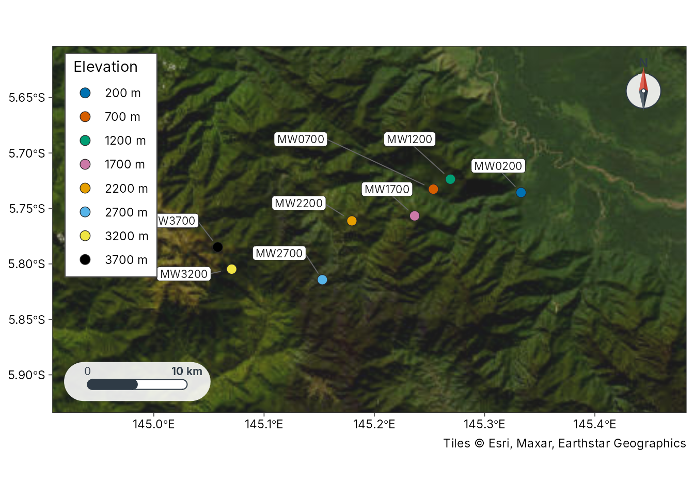
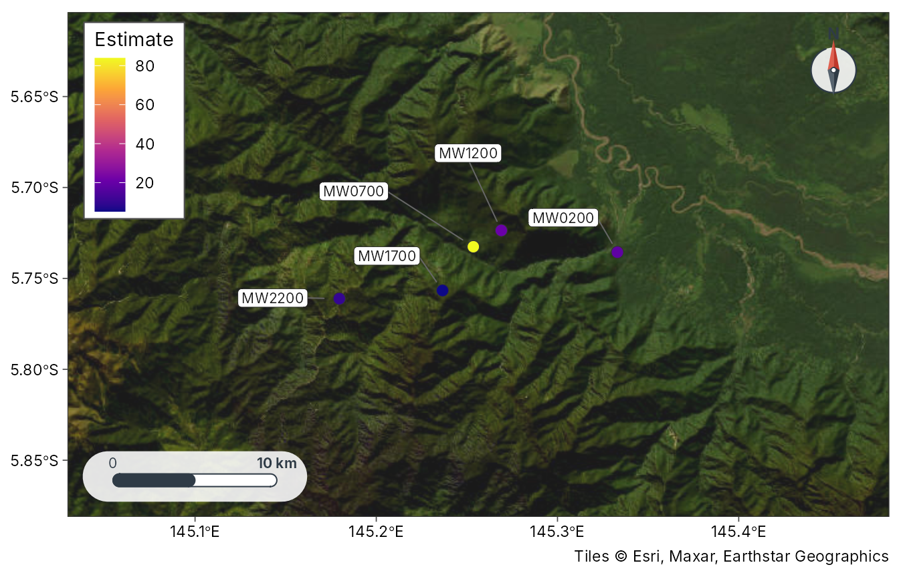

# Getting started with tidymapr

tidymapr is the mapping companion to
[tidydiversity](https://gitlab.com/jimmy.moses/tidydiversity). Every
verb takes a data frame and returns a tibble, an `sf` table, a
`SpatRaster` or a ggplot, so diversity estimates and maps stay in one
tidy workflow, in the same way dplyr and ggplot2 work together.

``` r
library(tidymapr)
```

## Study sites

[`geo_example_sites()`](https://tidymapr-e72c18.gitlab.io/reference/geo_example_sites.md)
returns the published bait GPS of the Mt Wilhelm ant survey behind
[`tidydiversity::png_ants`](https://rdrr.io/pkg/tidydiversity/man/png_ants.html)
(`png_ants_sites`; Mottl, Moses and Klimes 2023,
[doi:10.5281/zenodo.8191946](https://doi.org/10.5281/zenodo.8191946)),
one point per elevation band.

``` r
sites <- geo_example_sites("wilhelm")
sites
#> # A tibble: 8 × 6
#>   site     lon   lat elevation elevation_band coordinate_note                   
#>   <chr>  <dbl> <dbl>     <int> <fct>          <chr>                             
#> 1 MW0200  145. -5.74       200 200 m          published bait GPS, doi:10.5281/z…
#> 2 MW0700  145. -5.73       700 700 m          published bait GPS, doi:10.5281/z…
#> 3 MW1200  145. -5.72      1200 1200 m         published bait GPS, doi:10.5281/z…
#> 4 MW1700  145. -5.76      1700 1700 m         published bait GPS, doi:10.5281/z…
#> 5 MW2200  145. -5.76      2200 2200 m         published bait GPS, doi:10.5281/z…
#> 6 MW2700  145. -5.81      2700 2700 m         published bait GPS, doi:10.5281/z…
#> 7 MW3200  145. -5.80      3200 3200 m         published bait GPS, doi:10.5281/z…
#> 8 MW3700  145. -5.78      3700 3700 m         published bait GPS, doi:10.5281/z…
```

[`plot_sites()`](https://tidymapr-e72c18.gitlab.io/reference/plot_sites.md)
draws a publication-ready study-site map with a scale bar and north
arrow.

``` r
plot_sites(sites, lon, lat, colour = elevation_band, label = site)
```



## Sites as `sf` and distances

``` r
geo_as_sf(sites, lon, lat)
#> Simple feature collection with 8 features and 6 fields
#> Geometry type: POINT
#> Dimension:     XY
#> Bounding box:  xmin: 145.058 ymin: -5.81424 xmax: 145.333 ymax: -5.72361
#> Geodetic CRS:  WGS 84
#> # A tibble: 8 × 7
#>   site     lon   lat elevation elevation_band coordinate_note                   
#> * <chr>  <dbl> <dbl>     <int> <fct>          <chr>                             
#> 1 MW0200  145. -5.74       200 200 m          published bait GPS, doi:10.5281/z…
#> 2 MW0700  145. -5.73       700 700 m          published bait GPS, doi:10.5281/z…
#> 3 MW1200  145. -5.72      1200 1200 m         published bait GPS, doi:10.5281/z…
#> 4 MW1700  145. -5.76      1700 1700 m         published bait GPS, doi:10.5281/z…
#> 5 MW2200  145. -5.76      2200 2200 m         published bait GPS, doi:10.5281/z…
#> 6 MW2700  145. -5.81      2700 2700 m         published bait GPS, doi:10.5281/z…
#> 7 MW3200  145. -5.80      3200 3200 m         published bait GPS, doi:10.5281/z…
#> 8 MW3700  145. -5.78      3700 3700 m         published bait GPS, doi:10.5281/z…
#> # ℹ 1 more variable: geometry <POINT [°]>
```

``` r
head(geo_distance(sites, lon, lat, site = site))
#> # A tibble: 6 × 3
#>   site_1 site_2 distance
#>   <chr>  <chr>     <dbl>
#> 1 MW0200 MW0700    8802.
#> 2 MW0200 MW1200    7212.
#> 3 MW0200 MW1700   10931.
#> 4 MW0200 MW2200   17211.
#> 5 MW0200 MW2700   21767.
#> 6 MW0200 MW3200   30031.
```

## Diversity on a map with tidydiversity

Load both packages and pipe diversity estimates straight onto a map.

``` r
library(tidydiversity)
est <- div_estimate(png_ants, q = 0, nboot = 0, .by = season)
est <- dplyr::left_join(est, sites[c("site", "lon", "lat")], by = "site")
plot_geo(est[est$season == "dry", ], estimate, lon, lat, label = site)
```



[`geo_decay()`](https://tidymapr-e72c18.gitlab.io/reference/geo_decay.md)
joins geographic, elevational or environmental distances to
[`tidydiversity::beta_pair()`](https://rdrr.io/pkg/tidydiversity/man/beta_pair.html)
so
[`tidydiversity::beta_decay_model()`](https://rdrr.io/pkg/tidydiversity/man/beta_decay_model.html)
can fit distance-decay models.

See the article “Geospatial diversity workflows” for rasters, occurrence
cleaning, basemaps, bioclim layers, stem maps, spatial eigenvectors and
species distribution models.
